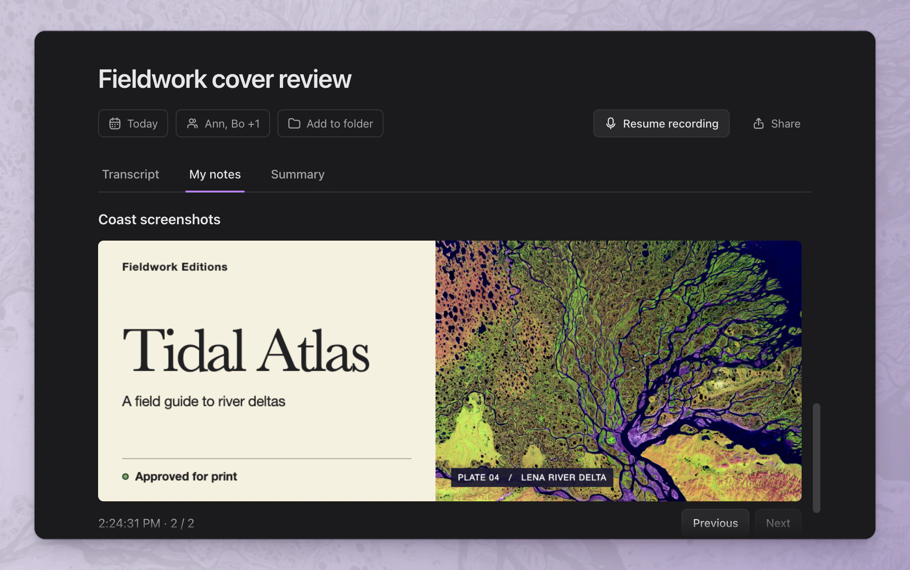

# Yogurt + Coast

Find a slide you saw in a meeting, even if nobody said its contents aloud. Yogurt + Coast is a macOS fork of Yogurt that puts selected screenshots beside your notes and makes the words on screen searchable.

**Run it on your Mac from source.** [Build instructions](docs/building.md#run-on-your-mac) · [User guide](docs/README.md) · [Connect Codex or Hermes](docs/README.md#connect-an-agent)

## From a call to a searchable note

1. Start a recording with Coast Local running. Yogurt records the conversation and lets you take notes.
2. Stop recording. Yogurt looks for screen changes during the recorded intervals. A local language model chooses useful moments, such as a new slide, a demo step, or a link shared in chat. Open **My notes → Coast screenshots** to see them with capture times.
3. Press **⌘K** to search for words in an image, or use **Ask** to get an answer with a screenshot reference. Apple Vision reads the selected images on your Mac.

In this fictional meeting, searching for **37 credits** brings up *Pilot planning*. The number appears only on the slide. [See the search result](docs/README.md#find-what-was-on-screen)

## Calendars and agent access

- **Calendars.** In **Agenda → Calendars**, choose individual calendars from the accounts already in Apple Calendar, including Google and iCloud. Checked calendars come first, followed by the Mac’s default and likely main account calendars. Your choices apply to the agenda, reminders, meeting matching, and agent calendar queries.
- **Agents.** Give Codex on your Mac or Hermes on another computer read-only access through the Model Context Protocol (MCP). An agent can find a meeting, read timestamped screen text, and ask questions across your notes. [Agent setup](docs/README.md#connect-an-agent)

## Where your data goes

Recording, transcription, screenshot selection, OCR, and Yogurt’s own meeting Q&A run on your Mac without a Yogurt account or backend. Setup downloads the models. Coast Local manages its own capture history. Yogurt copies selected images into its local meeting library. macOS handles calendar sync with your providers. If you connect an agent that uses a hosted model, the meeting content it reads can reach that provider. [Screenshot selection](app/src/main/coastSelection.ts) · [Apple Vision OCR](app/native/yogurt-mac/ScreenText.swift) · [MCP tools](app/src/main/mcp/server.ts)

This fork builds on Frigade’s work on local recording, transcription, summaries, and meeting search. Coast Local is installed separately. [Upstream Yogurt](https://github.com/FrigadeHQ/yogurt) · [Coast Local](https://coast.app/) · [MIT license](LICENSE) · [Third-party notices](THIRD_PARTY_NOTICES.md)
