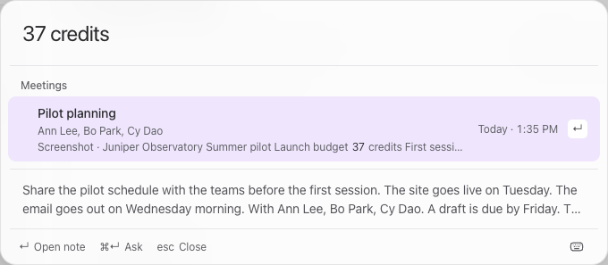
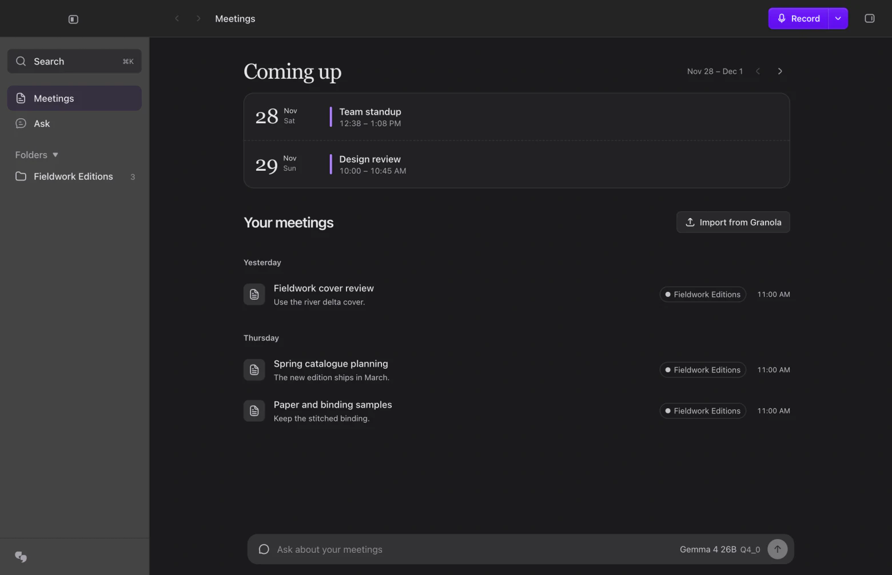

<p align="center">
  
</p>

<h1 align="center">Yogurt + Coast</h1>

<p align="center">
  <strong>An open-source, local alternative to Granola, with screen context.</strong><br />
  Your Mac turns calls into notes you can search by what people said and what they showed you.
</p>

<p align="center">
  <a href="#quick-start">Quick start</a> ·
  <a href="#search-a-shared-screen">Search a shared screen</a> ·
  <a href="#everyday-controls">Everyday controls</a> ·
  <a href="docs/README.md#connect-an-agent">Connect an agent</a>
</p>


In this fictional design review, the note says to send the selected cover to print. Its name, **Tidal Atlas**, appears only on the shared proof. Yogurt keeps that proof with the meeting.

## Search a shared screen

After recording stops, a local model picks useful screens from the call, such as a new slide, a demo step, or a link in chat. It skips paused intervals. Apple Vision reads the text in each saved image.

Press **⌘K** and enter words you remember seeing. Searching for **Tidal Atlas** finds the cover review even though the title never appears in the transcript or typed notes.

<p align="center">
  
</p>

## Quick start

The fork ships as source. It requires an Apple silicon Mac with macOS 14.4 or later and at least 8 GB of memory. Install Node.js 24, pnpm 10.7.0, CMake, and Xcode Command Line Tools. [Mac build guide](docs/building.md#run-on-your-mac)

1. **Set up screen capture.** Install Coast Local in Applications, grant screen recording access, enable its local CLI bridge, and leave it running. [Get Coast Local](https://coast.app/)
2. **Launch the fork.** Quit any existing copy of Yogurt first. Both builds use the same default meeting library.

   ```sh
   git clone https://github.com/guglielmofonda/yogurt-coast.git
   cd yogurt-coast
   pnpm install --frozen-lockfile
   pnpm -C app native
   pnpm dev
   ```

3. **Record your first call.** Let the local models download, then choose **Start recording**. After you stop, open **Screenshots**.

## Everyday controls

Home shows the next four days from your selected calendars, followed by your notes in date order. Use the question box to search for a decision across meetings.



| Task | Where to go |
| --- | --- |
| Bring existing Granola notes with you | On the Meetings home screen, choose **Import from Granola** and select the downloaded ZIP or CSV. Review the counts, then choose **Import notes**. [Migration guide](docs/README.md#bring-your-granola-notes-into-yogurt) |
| Revisit a slide or demo | Open **Screenshots**. Browse by capture time or click an image to enlarge it. |
| Ask about a decision | Open **Ask**. Answers can cite the transcript or the screenshot where the detail appeared. |
| Choose your calendars | Open **Agenda → Calendars** and check the calendars you want. Google and iCloud accounts already in Apple Calendar work here. |
| Give your agent read access | Enable **Settings → AI apps → Let AI apps read your meetings**. Connect Codex locally or Hermes over SSH with the read-only MCP helper. [Agent setup](docs/README.md#connect-an-agent) |

## What stays on your Mac

Recording, transcription, summaries, screenshot selection, OCR, and Yogurt’s own Q&A run locally. No Yogurt account or meeting bot is required. Coast Local manages its capture history separately. Yogurt copies the selected images into your meeting library.

Setup downloads models, and macOS syncs calendars with the providers you choose. If you connect an agent that uses a hosted model, the meeting content it retrieves can reach that provider. [User guide](docs/README.md) · [Screenshot selection code](app/src/main/coastSelection.ts) · [OCR code](app/native/yogurt-mac/ScreenText.swift)

Yogurt + Coast builds on Frigade’s open-source Yogurt. The example cover uses Lena River Delta imagery from USGS/NASA Landsat. [Upstream Yogurt](https://github.com/FrigadeHQ/yogurt) · [MIT license](LICENSE) · [Third-party notices](THIRD_PARTY_NOTICES.md) · [Image credit](https://science.nasa.gov/earth/earth-observatory/lena-river-delta-2704/)
