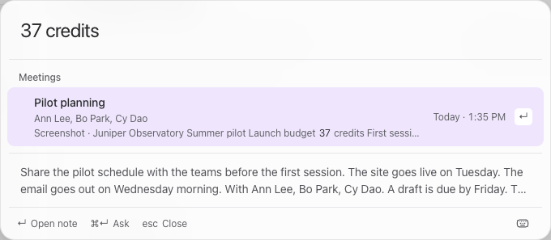

# Using Yogurt + Coast

Start with the [Mac build instructions](building.md#run-on-your-mac). Yogurt + Coast runs without a publisher account or a meeting bot.

## Attach screenshots after a call

1. Install **Coast Local** in **Applications**, open it, allow screen recording, and enable its local CLI bridge. Keep Coast running while you use the screenshot feature. [Get Coast Local](https://coast.app/)
2. Open Yogurt + Coast and finish the local model setup. If you installed Coast after opening Yogurt, quit and reopen Yogurt so it detects the bridge.
3. Choose **Start recording**. Take notes as usual. When recording stops, Yogurt asks Coast for frames from the recorded intervals and skips pauses. A local model uses screen changes, window titles, available text, and meeting context to select useful frames.
4. Open the finished meeting’s **Screenshots** tab. Click an image to enlarge it. Use **Previous** and **Next** when several images were selected.

Coast controls when it captures your screen. The recording window controls which frames Yogurt imports. If the gallery says **Screenshot selection is incomplete**, check that Coast is running and its local bridge is available, then click **Try again**. **No screenshots selected for this call** means processing finished with an empty selection.

## Find what was on screen

Apple Vision extracts text from each attached image. Press **⌘K** and enter a phrase from a slide or demo. A result labeled **Screenshot** shows the matching text and opens that image in **Screenshots**. In **Ask**, choose **Open screenshot** on a screenshot citation to see its source.



In this fictional design review, the shared cover proof is the only place the words “Tidal Atlas” appear. Saved images and their text live in Yogurt’s profile on your Mac, by default `~/Library/Application Support/Yogurt`.

## Bring your Granola notes into Yogurt

1. In Granola, open **Settings → Profile → Generate CSV** and select your workspaces. Download the export from Granola’s email. Granola includes notes you own that have a summary. [Granola’s export guide](https://docs.granola.ai/help-center/sharing/exporting-notes)
2. On Yogurt’s **Meetings** home screen, choose **Import from Granola**. Select the downloaded ZIP or an extracted CSV. Yogurt reads it locally, shows how many meetings are new, and lists skipped rows before you confirm.
3. Choose **Import notes**. Each meeting keeps its original creation date, personal notes, summary, and available transcript. Each workspace becomes a folder. Search and Ask can use the imported text. Importing the same meeting again preserves your edits in Yogurt.

The importer accepts up to 128 MB of uncompressed CSV data per import. You can select workspace CSVs individually for a larger export. Granola’s export contains text. Audio and Coast screen captures are available for meetings recorded with those features in Yogurt.

## Choose calendars

Open **Agenda → Calendars**, grant macOS calendar access, and check the calendars you want Yogurt to use. New installations start with an empty selection. Newly discovered calendars also start unchecked. Checked calendars appear first. Your selection applies to the agenda, reminders, meeting matching, and calendar queries from agents.

For Google, iCloud, or another account, add the account in Apple’s **Calendar → Add Account**, then return to the picker. macOS handles sign-in and provider sync. To narrow your agenda further, turn on **Hide events without a call link**. [Apple’s calendar account guide](https://support.apple.com/guide/calendar/add-calendars-and-calendar-accounts-icl4308d6701/mac)

## Connect an agent

Keep Yogurt + Coast open. In **Settings → AI apps**, turn on **Let AI apps read your meetings**. Leave **Let AI apps make changes** off for a query-only setup. Read access covers notes, transcripts, saved recordings, and screenshot text. The commands below also start the MCP helper with `--read-only`.

### Codex on the same Mac

For a packaged build in Applications, run:

```sh
codex mcp add yogurt-coast -- "/Applications/Yogurt + Coast.app/Contents/Resources/bin/yogurt-mcp" --read-only
```

If you use `pnpm dev`, run this instead from the root of the checkout:

```sh
codex mcp add yogurt-coast -- "$PWD/app/resources/bin/yogurt-mcp" --read-only
```

Open a new Codex chat. Ask it to search Yogurt for a term on a slide and quote the matching screen text with its capture time. The server provides `search`, `get_screenshot_text`, and `ask`, alongside meeting and calendar tools.

### Hermes on another computer

Use an existing SSH connection to the Mac holding your meetings. In this example its SSH alias is `meeting-mac`. With the packaged app open there, run the following on the Hermes computer:

```sh
hermes mcp add yogurt-coast --command /usr/bin/ssh --args -T meeting-mac '"/Applications/Yogurt + Coast.app/Contents/Resources/bin/yogurt-mcp" --read-only'
hermes mcp test yogurt-coast
```

For a source build, substitute the absolute helper path on the meeting Mac. Start a new Hermes session or use `/reload-mcp`. Keep the meeting Mac awake and reachable. SSH carries the query and its results between the two computers. A hosted model configured in either agent can receive the meeting content the agent retrieves.

## Report a problem

Include your macOS version, the fork commit you built, and what happened. Use fictional notes or screenshots if you need to show an example. [Open an issue in Yogurt + Coast](https://github.com/guglielmofonda/yogurt-coast/issues)
